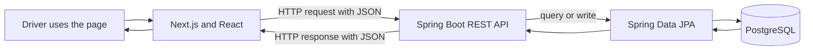

# Driver Logbook — Technical Study Guide

This guide follows a record from the browser form through the Java API and into PostgreSQL, then back to the page.

## 1. Project overview

Driver Logbook records fleet vehicles, shifts, inspections, and damage reports. It is full-stack because it combines a web frontend, an API server, and a database.

## 2. File map

| File or folder | Responsibility |
| --- | --- |
| `frontend/app/page.tsx` | Dashboard state, filters, forms, and HTTP requests. |
| `frontend/app/layout.tsx` | Shared HTML structure and page metadata. |
| `frontend/app/style.css` | Visual styling and responsive behavior. |
| `backend/.../DriverLogbookApplication.java` | Starts Spring Boot and configures local CORS. |
| `backend/.../ApiController.java` | HTTP routes, DTOs, validation, and business rules. |
| `backend/.../Domain.java` | JPA entities and their database relationships. |
| `backend/.../Repositories.java` | Interfaces used to query and save data. |
| `backend/src/main/resources/application.properties` | Server port and PostgreSQL configuration. |
| `docker-compose.yml` | Local PostgreSQL service configuration. |
| `frontend/package.json` / `backend/pom.xml` | Frontend and Java dependencies/build configuration. |

## 3. HTTP and REST concepts

When a user submits a form, the browser sends an HTTP request with a method, a path, and often a JSON body. `GET` reads data, `POST` creates a record or starts an action, and `PATCH` updates part of an existing record. An endpoint is a path such as `/api/vehicles`. HTTP status codes describe the outcome: 201 means created, 404 means not found, 409 means a conflict, and 422 means the submitted value cannot be processed.

## 4. The Next.js page

The `'use client'` directive marks `page.tsx` as a client component because it uses React state, browser events, and `fetch`. The main `data` state contains vehicles, shifts, and damage reports. The `API` constant reads `NEXT_PUBLIC_API_URL`, falling back to `http://localhost:8080/api`.

On first render, `useEffect` calls `refresh`. That function requests `GET /api/dashboard`, stores the response in state, and updates loading and connection indicators. The TypeScript `Data` type describes the JSON structure expected by the page.

The `Dialog` component collects form values. Its submit handler builds the JSON body and calls the `onSubmit` callback. The parent component provides `act`, which sends the HTTP request, surfaces API errors, and calls `refresh` after a successful change. Reloading from the API means the interface reflects the server's saved state.

## 5. Trace vehicle registration

1. The user opens the vehicle dialog and enters a fleet number, model, and license plate.
2. `Dialog` passes those fields to `act` with the `/vehicles` path.
3. `act` sends `POST /api/vehicles` with a JSON body.
4. `createVehicle` receives a `VehicleRequest` DTO in the controller.
5. `@Valid` and `@NotBlank` check required fields; the controller rejects a duplicate fleet number.
6. `VehicleRepository.save` asks JPA to persist the entity.
7. The API responds with HTTP 201; the frontend reloads the dashboard.

The same general path applies to the other forms: UI → HTTP → controller → rule → repository → database → response → refreshed UI.

## 6. Shift lifecycle and business rules

### Starting a shift

The page sends `vehicleId`, `startKm`, and departure inspection items to `POST /api/shifts`. `startShift` checks whether any shift is still open. If so, it returns 409. It then looks up the vehicle (404 if missing), creates and saves the shift, and saves inspection entries with the `INITIAL` phase.

### Ending a shift

The page sends the ending odometer, note, and return inspection to `POST /api/shifts/{id}/finish`. `finishShift` checks that the shift exists and is still open. It rejects an ending odometer below the start reading with 422; otherwise, it stores the end time, mileage, note, and final inspection.

HTML `required` and `min` attributes improve form feedback, but they are not business-rule enforcement. A caller can send requests without the page, so the backend repeats important validation.

## 7. Database model and JPA

In `Domain.java`:

- `Vehicle` stores fleet number, model, and license plate.
- `Shift` references a vehicle and stores start/end times and odometer readings.
- `Inspection` references a shift and stores phase, checklist item, and result.
- `Damage` references a vehicle and stores its description and status.
- Damage status is currently represented by the `DamageStatus` enum.

`@Entity` marks a class for persistence, `@Id` identifies a database row, and `@ManyToOne` expresses that multiple shifts can reference one vehicle. JPA translates Java objects and repository calls into SQL operations. Interfaces in `Repositories.java` extend `JpaRepository`; Spring Data supplies common query and save behavior.

## 8. Controller, DTOs, and validation

`ApiController` is the HTTP entry point. `@RestController` returns API responses, and `@RequestMapping("/api")` prefixes the routes. Records such as `VehicleRequest` and `FinishRequest` are DTOs (data transfer objects): they describe the request/response shape without exposing the persistence entity directly.

Annotations like `@NotBlank`, `@NotNull`, `@PositiveOrZero`, and `@Size` define input validation. The controller coordinates the request: it accepts a DTO, applies business rules, calls repositories, and returns a response.

## 9. API routes to know

| Method and path | Purpose |
| --- | --- |
| `GET /api/health` | Check that the API responds. |
| `GET /api/dashboard` | Load vehicles, shifts, and damage reports for the dashboard. |
| `GET /api/vehicles` / `POST /api/vehicles` | List or register vehicles. |
| `GET /api/shifts` | List shifts, optionally filtered by vehicle. |
| `POST /api/shifts` | Start a shift and save the departure inspection. |
| `POST /api/shifts/{id}/finish` | End a shift and save the return inspection. |
| `GET /api/damages` | List damage reports, optionally filtered by vehicle or status. |
| `POST /api/damages` | Create a damage report. |
| `PATCH /api/damages/{id}/status?status=IN_MAINTENANCE` | Change a damage report's status. |

## 10. Filters and known limits

The page filters shift history by vehicle and starting date, exports the visible shifts to CSV, and sums hours for completed shifts. The date filter is a starting date rather than a date range; the hours card includes all completed shifts even when the table is filtered; the table displays up to six records while its pagination controls are visual only; and Reports navigates to the history rather than a separate reports page.

## 11. Configuration and local run

Docker Compose starts PostgreSQL. `application.properties` configures port 8080 and local database defaults; `DATABASE_URL`, `DATABASE_USER`, and `DATABASE_PASSWORD` can override them. `NEXT_PUBLIC_API_URL` configures the frontend API address. The Spring application configures CORS for the local Next.js origin; if you use `127.0.0.1:3000` instead of `localhost:3000`, that origin must also be allowed.

Start PostgreSQL, run the backend with `mvn spring-boot:run` from `backend`, install frontend packages with `npm install` in `frontend`, and launch the UI with `npm run dev`.

## 12. Current scope and next steps

There is no authentication or per-driver data separation. The one-open-shift rule is application-wide, and damage photo uploads are not included. Hibernate uses `ddl-auto=update` to simplify local demos instead of versioned migrations. A production-oriented next step would add authentication, associate records with the signed-in driver, use Flyway migrations, support complete date ranges and server pagination, and keep a detailed audit trail.

## 13. Study exercises

1. Open browser DevTools → Network and register a vehicle. Note the method, path, JSON, and response.
2. Start a shift and trace `POST /api/shifts` from the browser to `startShift`.
3. Try to start a second shift and locate the 409 rule.
4. Submit an ending mileage below the starting value and find the 422 validation.
5. Create a damage report, change its status, and follow the `PATCH` request to the controller.
6. Add a field to `VehicleRequest` and trace every layer that needs to understand it.

## 14. Explain the project

> “The Next.js interface sends HTTP requests to a Spring Boot API. The controller validates DTOs, enforces shift rules, and calls JPA repositories. JPA persists related entities in PostgreSQL. The page then reloads the dashboard so it shows the state confirmed by the server.”
